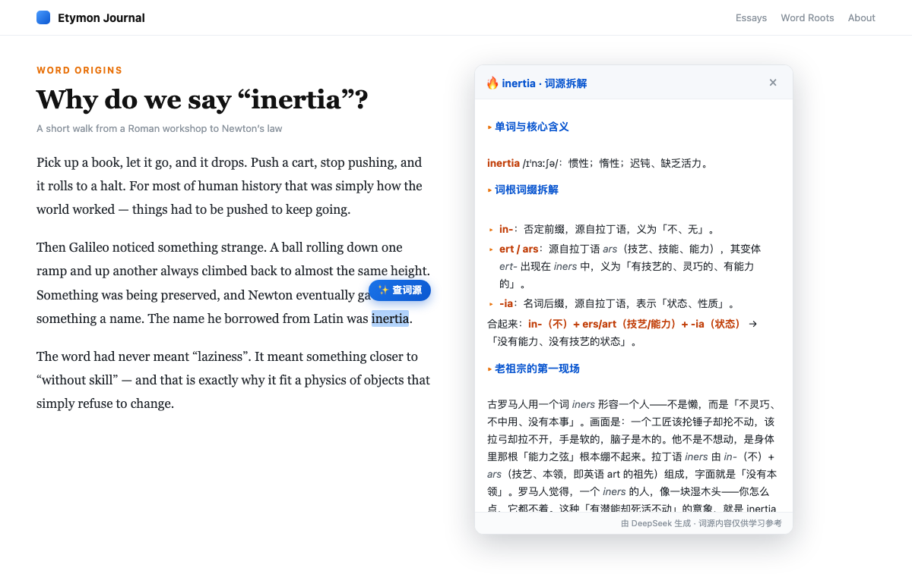
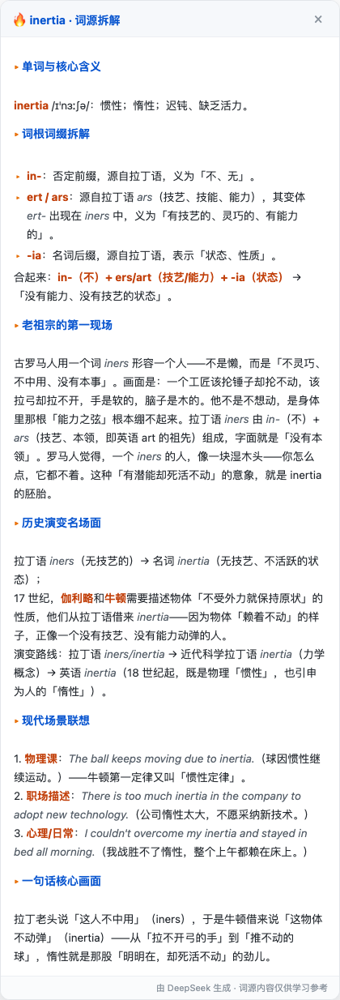
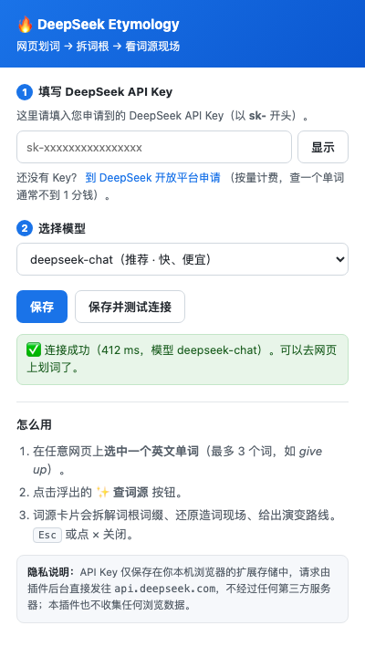

<div align="center">
  
  <h1>DeepSeek Etymology · 划词查词源</h1>
  <p><b>在任意网页上选中一个英文单词，一键看懂它的词根、词源和「老祖宗造词时的第一现场画面」。</b></p>
  <p>不只是告诉你「这个词是什么意思」，而是告诉你<b>它为什么是这个意思</b>。</p>
  <p>
    
    
    
    
  </p>
  <p><sub>76 项自动化测试，可自行验证 · 只有一个依赖：你自己的 DeepSeek API Key</sub></p>
</div>

---

## 📸 它长什么样

在网页上划一个词，点一下浮出来的按钮：



结果就是一张**词源拆解卡片**（下面是真实输出，未做任何美化）：



---

## 😖 这个工具解决什么痛点？

| 你现在的困境 | 传统单词书 / 词典 | DeepSeek Etymology |
| --- | --- | --- |
| 背单词靠死记硬背，**记了忘、忘了记** | 只给中文释义，记忆靠重复次数 | 给出**画面 + 故事 + 历史线**，记忆有钩子 |
| 一个词有 5 个意思，**不知道它们什么关系** | 5 条并列释义，看不出联系 | 讲清**隐喻延伸路径**，多义变一条线 |
| 遇到生词只能查，**不会猜词** | 查一个是一个 | 掌握词根后，**一个词根能撬动一串词** |
| 想查词源，但 etymonline 是英文、太学术 | 门槛高、要跳站 | 划词 → 20 秒，中文讲得**像纪录片** |
| 词根词缀书太枯燥，翻两页就弃 | 表格 + 罗列 | 还原**「老祖宗造词那一刻的第一现场」** |

### 为什么「词源」是学英语最高杠杆的投入？

一个单词不是随机符号。**salary** 来自「盐」（古罗马发军饷买盐），**window** 是维京人的「风之眼」，**inertia** 的本意是「没本事、不中用」。

> 当你知道了画面，单词就不再是需要背诵的 7 个字母，
> 而是一幅画、一条历史线、一个可以推导的结论。
> **这就是「记住」和「理解」的区别。**

而且词源知识是**可迁移资产**：学会 `spect`（看），你就能顺手拿下 inspect / respect / suspect / prospect / spectator；学会 `duc/duct`（引导），conduct / produce / reduce / introduce 全部打通。**背单词的边际成本会越来越低。**

---

## ✨ 功能

- **划词即查** —— 选中任意网页上的英文单词，点 `✨ 查词源`，不用复制粘贴、不用切标签页
- **结构化拆解** —— 固定六段式输出：核心含义 → 词根词缀拆解 → 老祖宗的第一现场 → 历史演变名场面 → 现代场景联想 → 一句话核心画面
- **词根溯源** —— 标明每个词根/前缀的**来源语言**（拉丁语、希腊语、古法语、古诺斯语…）与原义
- **演变路线图** —— 例如 `拉丁语 iners → 科学拉丁语 inertia → 英语 inertia`
- **现代场景锚点** —— 给出当代常见搭配与例句，把古老词源焊回今天
- **短语也能查** —— 最多支持 3 个词，`give up`、`in terms of` 都可以
- **Markdown 渲染 + 引号统一** —— 所有引号统一成「」，中文排版干净
- **零服务器** —— 请求由插件后台直接发往 DeepSeek，**没有中间人**

---

## 🚀 安装（3 分钟）

> 目前需要手动安装（还没上架 Chrome 应用商店）。全程不需要编程，跟着做就行。

### 第 1 步：下载代码

**方式 A（推荐 · 最干净）**：到 **[Releases 页面](https://github.com/JUNHAO88868/chrome-etymology/releases/latest)** 下载 `chrome-etymology-v1.1.0.zip`，解压得到一个文件夹。里面只有插件运行必需的文件。

**方式 B（拿完整源码）**：点本页右上角绿色的 **`Code`** → **`Download ZIP`**。这会连文档、截图和测试套件一起打包。

**方式 C（Git）**：
```bash
git clone https://github.com/JUNHAO88868/chrome-etymology.git
```

> 📁 无论哪种方式，都请解压到**一个你不会删掉的文件夹**里（比如「文档」下）。放在「下载」里被清理掉的话，插件就会失效。

### 第 2 步：加载到 Chrome

1. 在地址栏输入 `chrome://extensions` 并回车
2. 打开右上角的 **「开发者模式」** 开关
3. 点左上角 **「加载已解压的扩展程序」**
4. 选择你刚才解压出来的文件夹（**要选到里面有 `manifest.json` 的那一层**）

成功后你会看到名为 **DeepSeek Etymology** 的卡片。

> 支持 Chrome 110+，以及 Edge / Brave 等 Chromium 内核浏览器。

### 第 3 步：填入你的 DeepSeek API Key

安装后会自动弹出设置页（之后也可以点工具栏的插件图标打开）：



1. 到 **[DeepSeek 开放平台](https://platform.deepseek.com/api_keys)** 注册登录
2. 左侧 **API Keys** → **创建 API Key** → 复制那串 `sk-` 开头的字符串
3. 粘贴进插件的输入框 → 点 **「保存并测试连接」**
4. 看到 ✅ **连接成功** 就可以用了

> ⚠️ DeepSeek API 是**按量计费**，需要先充值才能调用（最低充值金额以平台为准）。查一个单词通常**不到 1 分钱**（一次查询约消耗 700–900 tokens，具体以[官方定价](https://api-docs.deepseek.com/quick_start/pricing)为准）。

---

## 🎯 使用方法

1. 在**任意网页**上，用鼠标选中一个英文单词（最多 3 个词）
2. 点浮出来的 **`✨ 查词源`**
3. 等 10–20 秒，词源卡片出现
4. 按 `Esc` 或点 `×` 关闭

**小技巧**：卡片可以上下滚动看完整内容；换个词再划一次，卡片会自动替换。

---

## 🔒 隐私与安全

这是我在设计时最在意的部分，你可以自己审计代码验证：

- ✅ **API Key 只存在你本机** —— 保存在 `chrome.storage.local`（浏览器扩展存储），不经过任何第三方服务器，作者也看不到
- ✅ **请求由插件后台直接发出** —— `content.js` 只负责画界面，真正带着 Key 去请求 `api.deepseek.com` 的只有 `background.js`。这样**网页本身拿不到你的 Key，也无法伪造请求**
- ✅ **不收集任何数据** —— 没有统计埋点、没有远程配置、没有广告
- ✅ **代码量极小** —— 全部逻辑 6 个文件，读完不到 10 分钟
- ✅ **没有硬编码 Key** —— 用的是你自己的 Key，作者不承担也不经手任何费用
- ✅ **输出内容经过 HTML 转义** —— 大模型返回的文本不会被当作 HTML 注入到网页里，避免 XSS 风险

> 🔐 **安全提醒**：如果你是从旧版本升级过来的，请注意 **绝对不要把 API Key 直接写进 `content.js`**。那样任何拿到代码的人都能盗用你的 Key。本项目已彻底改为「设置页填写 + 后台调用」的架构。

---

## ❓ 常见问题

<details>
<summary><b>点了按钮没反应 / 不出现「✨ 查词源」？</b></summary>

- 浏览器内置页面（`chrome://`、扩展商店、新标签页）不允许注入脚本，这是 Chrome 的限制，换普通网页试试
- 选中内容必须是**纯英文单词**（阿拉伯数字、中文、超过 3 个词都不会触发）
- 试试刷新页面；刚重装插件后，旧标签页需要刷新一次
</details>

<details>
<summary><b>提示「API Key 无效或已过期」？</b></summary>

去 [platform.deepseek.com](https://platform.deepseek.com/api_keys) 重新创建一个 Key。注意复制时不要带上多余空格，Key 一般以 `sk-` 开头。
</details>

<details>
<summary><b>提示「余额不足」？</b></summary>

DeepSeek 账户需要先充值。到开放平台的「充值」页面处理即可。
</details>

<details>
<summary><b>提示「请求太频繁（429）」？</b></summary>

短时间连续查太多次了，等几秒再试。
</details>

<details>
<summary><b>一直转圈 / 请求超时？</b></summary>

多数是网络问题。请确认：
- 当前网络能正常访问 `api.deepseek.com`
- 如果用了代理，请在系统/浏览器层面配置好（扩展的网络请求会走浏览器代理）
</details>

<details>
<summary><b>为什么不上架 Chrome 应用商店？</b></summary>

上架需要开发者账号（一次性 $5）并经过审核，且审核对「要求用户自备 API Key」的插件并不总是友好。目前先用「加载已解压的扩展程序」的方式分发，**功能完全一致**。如果你希望上架，欢迎在 Issues 里表达需求。
</details>

<details>
<summary><b>能换成别的模型或别的厂商吗？</b></summary>

可以。打开 `background.js`，改两个常量：
```js
const API_URL = 'https://api.deepseek.com/chat/completions';  // 换成任意 OpenAI 兼容的接口
const DEFAULT_MODEL = 'deepseek-chat';                        // 或 'deepseek-reasoner'
```
设置页里也可以直接切换 `deepseek-chat`（快、便宜）和 `deepseek-reasoner`（推理更强、更慢更贵）。
</details>

<details>
<summary><b>我能改提示词（Prompt）让它输出我想要的格式吗？</b></summary>

能。`background.js` 里的 `SYSTEM_PROMPT` 就是控制输出结构的核心，随便改。想让它输出更短、更学术、或者加音标/同根词，改这一段即可。
</details>

---

## 📂 项目结构

```
chrome-etymology/
├── manifest.json      # 扩展清单（MV3）：权限、入口、图标
├── background.js      # 后台：唯一持有 API Key 并发请求的地方 + 系统提示词
├── content.js         # 内容脚本：划词监听、按钮、词源卡片、Markdown 渲染
├── style.css          # 卡片样式（带 !important，防止被网页样式污染）
├── options.html       # 设置页 / 工具栏弹窗
├── options.js         # 设置页逻辑：保存 Key、切换模型、测试连接
├── icons/             # 图标（含 icon.svg 源文件）
├── tests/             # 76 项自动化测试（node tests/run.mjs）
├── assets/            # README 用的截图与横幅
├── .github/           # Issue 模板
├── CHANGELOG.md       # 更新日志
└── LICENSE            # MIT
```

**数据流**：`网页划词 → content.js →（消息）→ background.js →(带 Key)→ DeepSeek API → 渲染卡片`

---

## 🛠 本地开发与调试

```bash
git clone https://github.com/JUNHAO88868/chrome-etymology.git
```

改完代码后，在 `chrome://extensions` 点插件卡片上的 **🔄 刷新** 按钮，然后**刷新目标网页**。

- 调试 `content.js`：在网页上按 `F12`，看 Console
- 调试 `background.js`：`chrome://extensions` → 插件卡片 → 点 **「服务工作线程 / service worker」**

---

## 🧪 测试：76 项，你可以自己验证

上面说「76 项自动化测试全部通过」，你可以自己跑一遍确认：

```bash
node tests/run.mjs
```

```
DeepSeek Etymology · 测试套件

  ✓ background.js：35 通过
  ✓ content.js  ：24/24 通过
  ✓ options.js  ：17/17 通过

合计：76 通过 / 0 失败
```

只需要 **Node.js 18+** 和**任意一个 Chromium 内核浏览器**（找不到浏览器时会自动跳过 DOM 测试，逻辑测试照常运行）。退出码 `0` 表示全绿，可以直接接进 CI。

测试细节见 [tests/README.md](tests/README.md)。其中我特意留了一组**安全回归测试**：把 `` 当作大模型返回值喂进去，断言它必须被转义、不能真的在页面里生成元素、脚本不能执行——防止以后改代码时把 XSS 漏洞悄悄改回来。

---

## 🗺 Roadmap

- [ ] 一键把查过的词导出为 Anki 卡片 / Markdown 笔记
- [ ] 本地缓存：同一个词查过一次就不再花钱
- [ ] 同根词推荐（查 `spect` 时列出所有同根词）
- [ ] 生词本 + 复习提醒
- [ ] 流式输出（边生成边显示，首屏更快）
- [ ] Firefox / Edge 商店上架

> 有想法欢迎提 [Issue](https://github.com/JUNHAO88868/chrome-etymology/issues)。

---

## ⚠️ 免责声明

词源内容由**大模型生成**，可能存在史实偏差或杜撰。用于日常学习、记忆和理解词义通常没问题；若用于学术写作或考试，请以 [Etymonline](https://www.etymonline.com/)、OED 等权威词源词典为准。

本插件与 DeepSeek 官方无隶属关系，API 使用需遵守 [DeepSeek 开放平台的服务条款](https://platform.deepseek.com)。

---

## ⭐ 如果它帮到你了

点个 **Star** 是这个项目继续更新的最大动力。也欢迎把这个仓库分享给正在被单词折磨的朋友。

<div align="center">
  <br>
  <b>MIT License © 2026 JUNHAO88868</b>
</div>

---
---

# English

<div align="center">
  <b>Select any English word on any web page → see where it actually comes from.</b>
</div>

**DeepSeek Etymology** is a Chrome extension (Manifest V3) that explains a word's **etymology** — its roots, prefixes, and the original scene that gave birth to the word — instead of just handing you a Chinese translation.

### The problem it solves

Flashcards make you memorize; etymology makes you *understand*. When you know that **salary** comes from "salt", **window** is Old Norse for "wind-eye", and **inertia** literally meant "without skill", a word stops being an arbitrary string of letters and becomes a picture plus a story. Root knowledge also compounds: learn `spect` (to look) once and you unlock inspect, respect, suspect, prospect and spectator for free.

### Features

- **Select-to-query** — highlight a word on any page, click `✨ 查词源`, done. No copy-paste, no tab switching.
- **Structured breakdown** — six fixed sections: core meaning → root/affix dissection → "the ancestor's first scene" → historical evolution → modern usage anchors → one-sentence mental image.
- **Etymology lineage** — e.g. `Latin iners → scientific Latin inertia → English inertia`.
- **Phrases supported** — up to 3 words, so `give up` works too.
- **Zero backend** — requests go straight from the extension's background worker to DeepSeek. No middleman, no analytics, no data collection.

### Install

1. **Download** — click the green `Code` button above → `Download ZIP`, then unzip it somewhere permanent. (Or `git clone https://github.com/JUNHAO88868/chrome-etymology.git`.)
2. **Load it** — open `chrome://extensions`, turn on **Developer mode** (top-right), click **Load unpacked**, and select the folder that contains `manifest.json`.
3. **Add your key** — the settings page opens automatically. Get an API key at [platform.deepseek.com/api_keys](https://platform.deepseek.com/api_keys), paste it in, and click **保存并测试连接** (Save & test connection). DeepSeek's API is pay-as-you-go, so you'll need a small balance; a single lookup usually costs well under ¥0.01.

### Usage

Select an English word on any web page → click **`✨ 查词源`** → read the card. Press `Esc` or click `×` to close.

### Privacy & security

- Your API key is stored **locally only**, in `chrome.storage.local`. It is never sent to the author or any third party.
- The API call is made from `background.js`, **not** from the page context — so web pages can neither read your key nor forge requests.
- Model output is **HTML-escaped** before rendering, preventing XSS.
- No telemetry, no remote config, no ads. The whole extension is 6 small files you can audit in minutes.

### Notes

- Chrome 110+ (also works on Edge, Brave and other Chromium browsers).
- Words must be plain English (no digits, no CJK); up to 3 words per lookup.
- Etymology text is **LLM-generated** and may contain inaccuracies — for academic use, verify against [Etymonline](https://www.etymonline.com/) or the OED.
- Switch between `deepseek-chat` (fast, cheap) and `deepseek-reasoner` (stronger, slower, pricier) in the settings page.
- Not affiliated with DeepSeek.

**MIT License © 2026 JUNHAO88868** — if this helps you, a ⭐ would be much appreciated.
